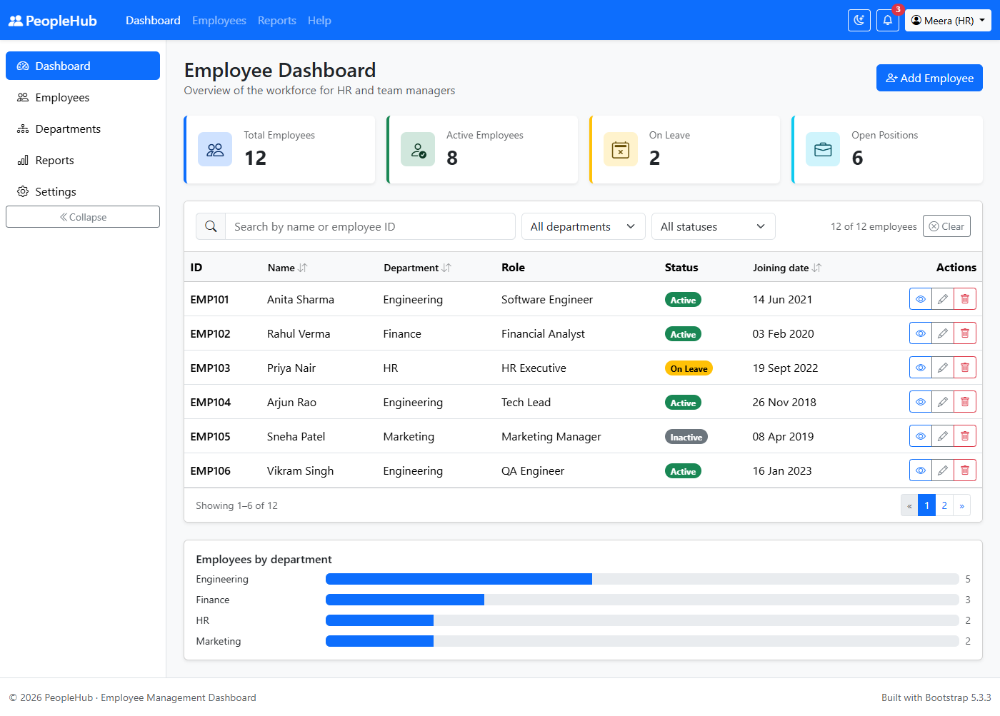
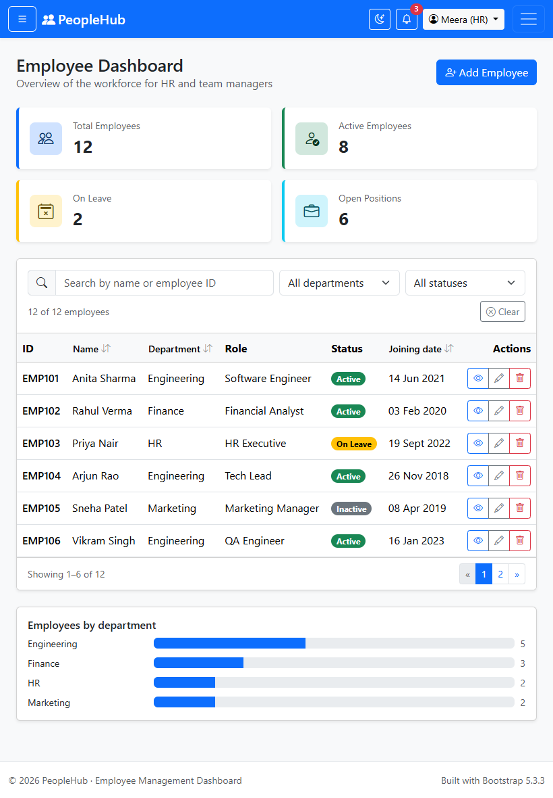
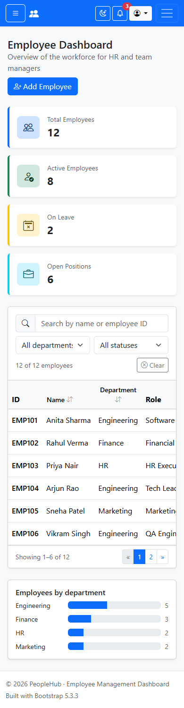
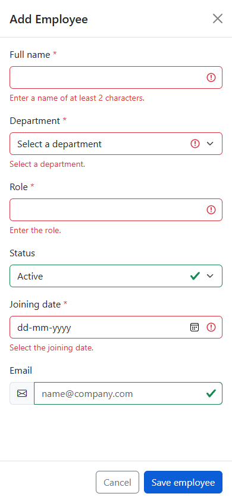
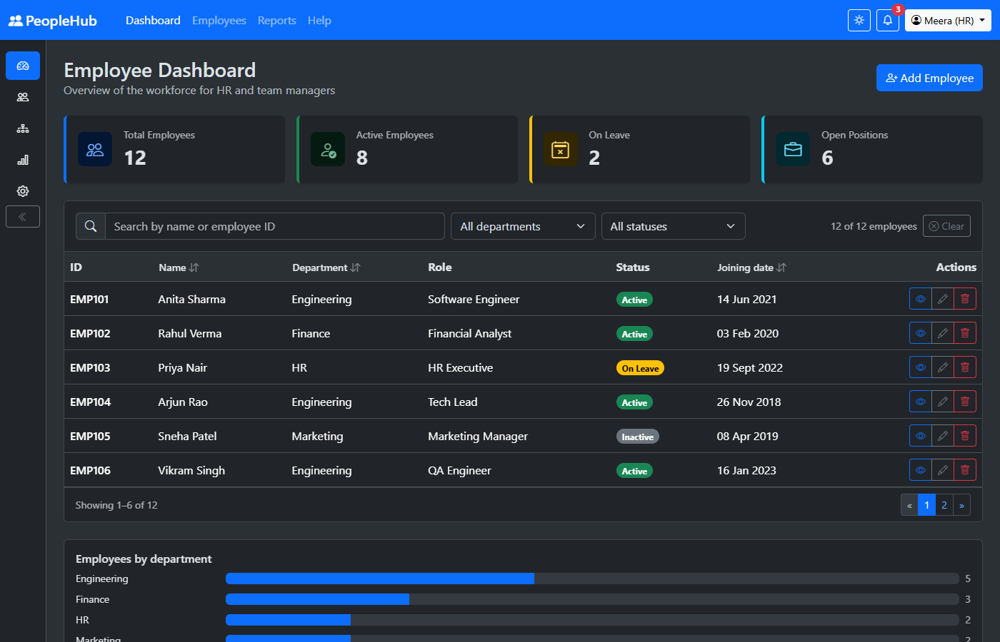

# PeopleHub — Responsive Employee Management Dashboard

A responsive employee management dashboard for HR and team managers. It is built with **HTML5, CSS3, Bootstrap 5.3.3 and plain JavaScript**. Users can see employee statistics, search and filter employee records, add, view, edit and delete employees, and use the same page on desktop, tablet and mobile.

## Setup and run

No installation or build step is needed to use it (npm is only for the tests).

1. Open the `employee-dashboard` folder.
2. Double-click **`index.html`**, or open it in any modern browser (Chrome, Edge, Firefox).

**Optional:** serve the folder instead of opening the file, e.g. with VS Code's *Live Server* extension, or `npx serve .` in this folder.

Bootstrap and Bootstrap Icons are included locally in `vendor/`, so the page also works **offline**.

## Versions

| Library | Version | Files |
|---|---|---|
| Bootstrap | **5.3.3** | `vendor/bootstrap/bootstrap.min.css`, `vendor/bootstrap/bootstrap.bundle.min.js` (includes Popper for dropdowns) |
| Bootstrap Icons | 1.11.3 | `vendor/bootstrap-icons/` |

## Project structure

```text
employee-dashboard/
├── index.html          page structure: navbar, sidebar, KPI row, toolbar, table, modals, footer
├── css/styles.css      the few rules Bootstrap does not provide (sticky sidebar, collapsed sidebar, dark table header)
├── js/logic.js         the rules that do not touch the page: checking and cleaning data, search, sort, paging, counts
├── js/data.js          mock data: 12 employees (the 5 from the brief first)
├── js/app.js           state, rendering, form handling, actions, theme (uses logic.js)
├── vendor/             Bootstrap 5.3.3 and Bootstrap Icons
├── tests/              unit tests for logic.js (Node's built-in test runner)
├── e2e/                browser tests (Playwright) that drive the real page
└── docs/screenshots/   desktop, tablet and mobile screenshots
```

## How the requirements are met

| Area | Implementation |
|---|---|
| Layout | `container-fluid` → `row` → sidebar column (`col-lg-2`) + main column (`col`); footer pinned with `d-flex flex-column min-vh-100` + `mt-auto` |
| Header | Bootstrap **navbar** (`navbar-expand-lg`, collapses to a toggler below 992 px) with brand, links, **theme toggle**, **notification button with badge** and dropdown, **profile dropdown** |
| Sidebar | Dashboard, Employees, Departments, Reports, Settings as `nav-pills`. It uses **`offcanvas-lg`**: a normal column on desktop, a slide-in panel opened by the ☰ button on tablet and mobile |
| KPI cards | four Bootstrap **cards** in `col-12 col-sm-6 col-xl-3`: **1 row on desktop, 2×2 on tablet, stacked on mobile**. Values are computed from the data (Total, Active, On Leave, Open Positions) |
| Toolbar | **input group** search (name or ID), department and status **selects** in grid columns, result count, Clear button |
| Employee table | `table table-hover align-middle` inside **`table-responsive`**; status **badges** (green Active, yellow On Leave, grey Inactive); **View / Edit / Delete** button groups |
| Add employee | Bootstrap **modal** (`modal-fullscreen-sm-down`, so it fills a phone screen) with a `needs-validation` form, **validation styles** (`was-validated`, `invalid-feedback`), input groups and full-width fields on mobile |
| Alerts | dismissible Bootstrap **alerts** confirm add / update / delete |
| Footer | copyright and application information |
| Utilities | spacing (`p-*`, `m-*`, `g-*`, `gap-*`), flex (`d-flex`, `justify-content-*`, `align-items-*`), display (`d-none d-sm-inline`, `d-lg-none`), sizing, text (`text-body-secondary`, `fw-*`, `small`), borders, shadows |

There are **no fixed pixel widths** for the page sections. Everything is grid columns and breakpoints, and there are no separate desktop and mobile pages.

## Responsive behaviour

| Screen | Behaviour |
|---|---|
| **Desktop** (≥ 992 px) | sidebar visible (and collapsible to icons); navbar links shown; KPI cards in one row (≥ 1200 px); the whole table visible |
| **Tablet** (576–991 px) | sidebar becomes an off-canvas menu (☰); navbar links collapse into the toggler; KPI cards wrap into 2 × 2; the table fits or scrolls inside its card |
| **Mobile** (< 576 px) | navigation collapses; brand shows its icon only; KPI cards stack; filters wrap below the search; the Add form fills the screen with full-width fields; the table scrolls **sideways inside its card**, so the page itself never scrolls horizontally |

## Functions

- **Search** by name or employee ID (case-insensitive), as you type.
- **Filters:** department (Engineering, Finance, HR, Marketing) and status (Active, Inactive, On Leave).
- **Combined filtering:** search and both filters work together. "Clear" resets all three.
- **Add Employee:**
  - required: name (2+ characters, not blank), department, role (2+ characters) and joining date
  - the joining date cannot be in the future
  - the email is optional but must be valid
  - new IDs continue the sequence: EMP113, EMP114, …
- **View** opens a details modal. **Edit** reopens the form pre-filled. **Delete** asks for confirmation.
- When nothing matches, the table shows "No employees match the search and filters."

## Optional challenges implemented

1. **Collapsible sidebar:** the Collapse button shrinks it to icons on desktop.
2. **Dark/light theme toggle:** uses Bootstrap 5.3 colour modes (`data-bs-theme`). The choice is remembered.
3. **Pagination:** 6 employees per page, with Bootstrap pagination.
4. **Sorting:** by name, department or joining date. Click a column header again to reverse.
5. **Employee details modal**, from the View button.
6. **Department chart:** a responsive breakdown built from Bootstrap progress bars, so no chart library is needed.
7. **localStorage:** added, edited and deleted employees are kept after a reload.

## Assumptions

- **Mock data:** no backend. The data comes from `js/data.js`. The five employees from the brief come first; seven more were added so that pagination and the filters have something to show.
- **Open Positions** is a fixed number (6) in `data.js`, because the brief gives no data for it.
- **Header extras:** the header links, notifications and profile menu are visual only, as the brief asks only for them to be present.
- **Resetting the data:** clear the site data in the browser, or run `localStorage.clear()` in the browser console.

## Safety

The page has no server, but it still handles typed text and saved data carefully:

- **Saved data is not trusted.** Anything kept in the browser's storage can be edited with the developer tools, so every record is checked when it is loaded: the ID must look like `EMP101`, the department and status must be from the fixed lists, the date must be a real date that is not in the future, and the text is cleaned. Records that fail are dropped (if nothing usable is left, the sample data comes back). Unknown extra properties are not carried over.
- **Text is shown as text.** Names, roles and emails are escaped before they are placed in the page, so `<script>` or `` typed into a field is displayed literally and never runs. The same escaping is used for IDs, departments and statuses.
- **The rules run twice.** The form uses Bootstrap's validation, and the same rules run again in code before anything is saved (name and role 2 to 60 characters, email optional but valid and at most 100, a real date between 1970 and today).
- **A content security policy** (a `<meta>` tag in `index.html`) allows only this folder's own scripts, styles, fonts and images, blocks plug-ins, and stops the page sending data anywhere.
- **Dates use your local day.** "Today" for the future-date check is your own calendar day (not the UTC day, which is yesterday for a few hours each morning in India). IDs sort by number, so EMP1000 comes after EMP999.

## Testing

```bash
npm install        # once; only needed for the browser tests
npm test           # 24 unit tests for js/logic.js (Node 18+, nothing to install)
npm run test:e2e   # 11 browser tests (Playwright, uses the Chrome installed on your computer)
```

- **Unit tests** cover the date and text helpers, the form rules (each field, the length limits, today allowed, future refused), cleaning of tampered saved data, search, filters and their combination, sorting (numeric IDs, unknown columns, the original list left unchanged), the next ID, paging limits, department counts and date formatting.
- **Browser tests** open `index.html` straight from disk and check: the KPIs and first page, search, filters, empty state and Clear, sorting and paging, the form refusing bad input, add / edit / view / delete and persistence after a reload, that script typed into a field and tampered saved data never run, the remembered theme, and at **1400, 820 and 390 px** that the page never scrolls sideways and the sidebar is visible on desktop and behind the menu button otherwise. Every test also fails on any console error, which includes content-security-policy violations.

## Screenshots

**Desktop (1400 px)**



**Tablet (820 px)**



| Mobile (390 px) | Mobile menu (off-canvas sidebar) | Mobile Add Employee with validation |
|---|---|---|
|  |  |  |

**Desktop, dark theme, collapsed sidebar**


