# CartNest: E-commerce Store

An online store in the style of Amazon, Flipkart and Myntra. It has a Spring Boot REST API (`backend/`) with MySQL, and a React front end (`frontend/`).

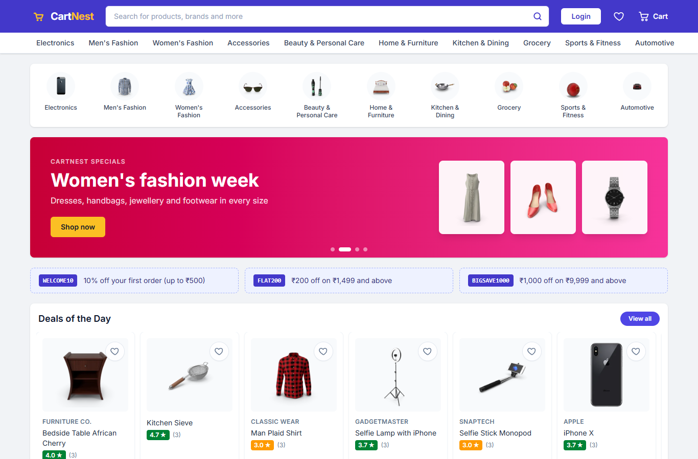

## What it does

| Shoppers | Admins |
|---|---|
| Browse 52 categories and 194 products (337 sizes and options); search with suggestions; filter by brand, price, size, rating, discount and stock; sort 7 ways | Dashboard: revenue, a 14-day sales chart, orders by status, best sellers, low stock |
| Product pages with a gallery, size or storage options, stock warnings, specifications, ratings and reviews | Move orders Placed → Confirmed → Shipped → Delivered, or cancel them with a refund |
| Accounts with JWT login, an address book, a wishlist and a cart saved on the server | Add and edit products with their variants, images and specifications; show or hide them |
| Checkout with coupons and cash on delivery, UPI or card (simulated); stock is reserved safely | Manage categories, brands and coupons; disable customer accounts |
| Order tracking and cancellation; reviews of delivered products | |

## Quick start

1. MySQL 8 running on `localhost:3306`.
2. **Backend:** create `backend/src/main/resources/db-secret.properties` and `jwt-secret.properties` (see *Running the backend*), then run `CartNestApplication` in Eclipse, or `mvn spring-boot:run` in `backend`.
3. **Front end:** `cd frontend`, `npm install`, `npm run dev`, then open http://localhost:5173.
4. **Log in** as `riya@example.com` / `Customer@123` to shop, or `admin@cartnest.in` / `Admin@123` for the admin area.

## Project structure

```text
E-commerce App/
├── backend/                 Spring Boot 3.5.6, Java 17, Maven
│   ├── src/main/java/com/cartnest/
│   │   ├── config/          security (JWT, roles), CORS, demo-order seeder
│   │   ├── controller/      REST controllers (admin/ for /api/admin/**)
│   │   ├── dto/             request and response records (dto/admin for the admin API)
│   │   ├── entity/          JPA entities
│   │   ├── exception/       business exceptions and the global error handler
│   │   ├── repository/      Spring Data repositories, search Specifications
│   │   ├── security/        JWT service and filter, JSON 401/403
│   │   └── service/         business rules
│   ├── src/main/resources/db/migration/   Flyway: V1 catalogue tables, V2 catalogue data, V3 customer tables, V4 orders and coupons
├── frontend/                React 19, TypeScript, Vite, Tailwind CSS, React Router, TanStack Query
│   └── src/  api/  auth/  components/  pages/ (shop)  admin/ (admin area)
├── data/                    DummyJSON snapshot and build_catalog.py (generates V2)
└── docs/screenshots/
```

## Catalogue

| | |
|---|---|
| Categories | **52**: 10 departments (Electronics, Men's Fashion, Women's Fashion, Accessories, Beauty & Personal Care, Home & Furniture, Kitchen & Dining, Grocery, Sports & Fitness, Automotive) with 42 sub-categories |
| Products | **194**, from 63 brands, with **337 variants** (the items actually stocked: sizes, storage options, laptop configurations) |
| Images | 474, linked from DummyJSON's image server (an internet connection is needed to see them) |
| Reviews | 581, from 191 customer accounts |

**Where the data comes from:** [DummyJSON](https://dummyjson.com/products), saved in `data/dummyjson-products.json`. `data/build_catalog.py` turns it into the Flyway migration `V2__catalog_data.sql`:
- builds the category tree from DummyJSON's categories and tags
- converts USD prices to rupees (×85, rounded to a price ending in 9) and works out each MRP from the discount
- adds sizes S–XXL to clothing, UK sizes to footwear, 128/256/512 GB to phones and tablets, and two RAM/SSD options to laptops
- creates an account for every reviewer

Run it again with `python data/build_catalog.py`.

## Running the backend

You need Java 17+, Maven, and MySQL 8 running on `localhost:3306`.

1. Create two git-ignored files in `backend/src/main/resources/`:
   - `db-secret.properties` containing `spring.datasource.password=<your MySQL root password>`
   - `jwt-secret.properties` containing `app.jwt.secret=<any random text of 32+ characters>`, the key that signs login tokens
2. In Eclipse, import `backend` as an *Existing Maven Project* and run `CartNestApplication`, or run `mvn spring-boot:run` in `backend`.
3. The API runs on http://localhost:8080. On first start:
   - Flyway creates the database `ecommerce_db`, the tables and the catalogue.
   - `DemoOrderSeeder` adds about 160 past orders (the last 45 days, dated relative to today) so the admin dashboard has data. It runs only while the database has fewer than 20 orders. Switch it off with `app.seed.demo-orders=false`.

## Running the front end

You need Node.js 20+. With the backend running:

```bash
cd frontend
npm install        # first time only
npm run dev        # http://localhost:5173
```

The Vite dev server forwards every `/api` request to the backend on port 8080, so the browser talks to a single address. Build for production with `npm run build`.

**Demo accounts:**

| Email | Password | Role |
|---|---|---|
| `admin@cartnest.in` | `Admin@123` | ADMIN |
| `riya@example.com` | `Customer@123` | CUSTOMER |
| any reviewer, e.g. `eleanor.collins@example.com` | `Customer@123` | CUSTOMER |

## Catalogue API (public)

| Method | URL | Returns |
|---|---|---|
| GET | `/api/home` | category tree and product rails: Deals of the Day, Top Rated, New Arrivals, Best of each department |
| GET | `/api/categories` | the category tree with product counts |
| GET | `/api/categories/{slug}` | one category with its breadcrumb and sub-categories |
| GET | `/api/brands` | brands with product counts |
| GET | `/api/products` | a page of products plus filter options (see below) |
| GET | `/api/products/{slug}` | product page: images, variants with stock, specifications, rating breakdown, latest reviews, similar products |
| GET | `/api/products/{slug}/reviews?page=&size=&sort=newest\|highest\|lowest` | reviews, page by page |
| GET | `/api/search/suggest?q=` | search-box suggestions: up to 6 products, 4 categories, 4 brands |

### `GET /api/products` parameters (all optional)

| Parameter | Example | Meaning |
|---|---|---|
| `category` | `electronics` | a category slug; includes its sub-categories |
| `q` | `apple phone` | text search: every word must appear in the title, description, brand, category or tags |
| `brand` | `apple,samsung` | brand slugs |
| `minPrice`, `maxPrice` | `1000`, `50000` | price range in ₹ |
| `minRating` | `4` | average rating at least |
| `minDiscount` | `20` | discount % at least |
| `sizes` | `M,L` or `UK 9` | at least one of these sizes in stock |
| `inStock` | `true` | only products with stock |
| `sort` | `relevance`, `popularity`, `price_asc`, `price_desc`, `newest`, `discount`, `rating` | defaults to `relevance` when searching, `popularity` otherwise |
| `page`, `size` | `0`, `24` | paging; `size` is 1–60 |

The response contains `items`, the paging fields and `facets`. The facets are the options the filter sidebar can show: sub-categories, brands, price range, sizes, ratings and discounts, each with a count. They are based on the category and search text only, so picking one brand does not hide the others.

**How search ranks results.** Each search word scores by where it matches: title 3, category 2, brand 2, tag 1. Results are ordered by the total score, then by number of reviews. So "apple phone" lists the iPhones before Apple AirPods. Matching is by substring, so "phone" also matches "Earphones".

**Errors** all share one shape:

```json
{"status":400,"error":"Bad Request","message":"size: size must be between 1 and 60",
 "path":"/api/products","fieldErrors":{"size":"size must be between 1 and 60"},"timestamp":"..."}
```

| Situation | Status |
|---|---|
| invalid parameter, or `minPrice` above `maxPrice` | 400 |
| unknown product or category | 404 |

## Accounts and login

`POST /api/auth/login` (or `/register`) returns a token valid for 12 hours. Send it on every other call as `Authorization: Bearer <token>`.

| Method | URL | Who | Purpose |
|---|---|---|---|
| POST | `/api/auth/register` | anyone | `{fullName, email, password, phone?}`: creates a CUSTOMER and logs them in (201) |
| POST | `/api/auth/login` | anyone | `{email, password}` |
| GET | `/api/auth/me` | logged in | the current user |
| PUT | `/api/account/profile` | logged in | `{fullName, phone}` |
| PUT | `/api/account/password` | logged in | `{currentPassword, newPassword}` (204) |

**Login rules:**
- **Emails** are not case-sensitive.
- **Passwords:** 8–64 characters with at least one letter and one digit, stored as BCrypt hashes.
- **Phone:** a 10-digit Indian mobile number.
- **Failed logins:** a wrong password, an unknown email and a disabled account all get the same 401 "Incorrect email or password". After **5 failures in a row the email is locked for 15 minutes** (429).
- **Every request re-checks the user,** so a disabled account's token stops working at once.

**Who may call what:**

| URLs | Access |
|---|---|
| catalogue (`GET /api/home`, `/categories`, `/brands`, `/products`, `/search`) | public |
| `/api/cart`, `/api/wishlist`, `/api/addresses` | CUSTOMER |
| `/api/admin/**` | ADMIN |
| everything else under `/api` | any logged-in user |

Missing or invalid tokens get 401; the wrong role gets 403. Both use the usual JSON error shape.

## Cart, wishlist and addresses (CUSTOMER)

| Method | URL | Purpose |
|---|---|---|
| GET | `/api/cart` | lines, totals and `checkoutReady` |
| POST | `/api/cart/items` | `{variantId, quantity?}`: adds to the line if the variant is already in the cart |
| PUT | `/api/cart/items/{id}` | `{quantity}` |
| DELETE | `/api/cart/items/{id}` | remove a line |
| POST | `/api/cart/items/{id}/move-to-wishlist` | "save for later" |
| DELETE | `/api/cart` | empty the cart |
| GET / POST | `/api/wishlist` | list / `{productId}`: 201 when added, 200 if it was already there |
| DELETE | `/api/wishlist/{productId}` | remove |
| GET / POST | `/api/addresses` | list (default first) / add |
| PUT / DELETE | `/api/addresses/{id}` | edit / delete |
| PUT | `/api/addresses/{id}/default` | make it the default |
| GET | `/api/addresses/states` | the 36 accepted states and union territories |

Every cart call returns the whole updated cart.

**Cart rules:**

| Rule | Result |
|---|---|
| at most 10 of one item | 400 / 409 |
| never more than the stock ("Only 3 of … left in stock") | 409 |
| sold-out variants cannot be added | 409 |
| at most 50 different items | 409 |

**Prices and delivery:**
- The summary shows the total MRP, the discount, the subtotal, the delivery fee and the total.
- **Delivery is free from ₹499**; below that it costs ₹40.

**When stock runs low after adding:** if a line can no longer be bought as it is (stock fell below the quantity, sold out, or product withdrawn), it is listed with a `problem` and left out of the totals, and `checkoutReady` is false.

**Address rules:**
- **Fields:** a 6-digit pincode that does not start with 0, a 10-digit mobile number, and a real Indian state (any letter case; stored with its official spelling).
- **Limit:** at most 10 addresses.
- **Default:** there is always exactly one default. The first address becomes the default, and deleting the default promotes the newest remaining address.
- **Privacy:** another customer's address, cart line or wishlist item answers 404, as if it did not exist.

## Checkout and orders (CUSTOMER)

| Method | URL | Purpose |
|---|---|---|
| GET | `/api/coupons` | coupons this customer can still use |
| POST | `/api/checkout/preview` | `{addressId?, couponCode?}`: cart lines and every total with the coupon applied, the coupon's message, the delivery address (default if none given), `codAvailable`, `checkoutReady` |
| POST | `/api/orders` | `{addressId, paymentMethod: COD\|UPI\|CARD, couponCode?, upiId?}`: places the order (201) |
| GET | `/api/orders?page=&size=` | my orders, newest first |
| GET | `/api/orders/{orderNumber}` | details: items, delivery address, payment, totals, tracking timeline |
| POST | `/api/orders/{orderNumber}/cancel` | `{reason?}`: cancel before shipping |

**What placing an order does** (all in one transaction, so either everything happens or nothing does):
1. It locks the variants being bought (`SELECT … FOR UPDATE`, always in id order so two orders cannot deadlock). The variants are read only through this lock, so a checkout that had to wait sees the stock the other order left.
2. It checks every line: the product is still sold and enough stock is left. Otherwise it answers 409, e.g. "Only 2 of Tray left".
3. It copies the address, titles, sizes and prices into the order, so later edits to the catalogue or address book do not change past orders.
4. It applies the coupon (locked, so a usage limit cannot be overshot) and the delivery fee: free from ₹499, otherwise ₹40.
5. It reduces the stock.
6. It takes the payment, then empties the cart.

**Payment and limits:**
- **Simulated payment:** UPI and card payments go through `PaymentGateway`, a stand-in that moves no money and asks for no card details. A UPI id ending in **`@fail`** is declined (402), and nothing is saved.
- **Cash on delivery** is allowed up to ₹50,000. The payment stays PENDING until delivery.

**Who can do what:**

| Situation | Result |
|---|---|
| two customers buy the last unit at the same moment | one gets it, the others get "… is out of stock" |
| cancel an order before it ships (PLACED or CONFIRMED) | stock comes back, an online payment is REFUNDED, the coupon use is freed |
| cancel a shipped, delivered or already cancelled order | 409 |
| another customer's order | 404 |

**Order numbers** look like `CN261030482915`: CN, the date, then 6 random digits.

**Coupons** (in the V4 migration):

| Code | Offer | Minimum order | Limits |
|---|---|---|---|
| `WELCOME10` | 10% off, up to ₹500 | ₹999 | once per customer |
| `FLAT200` | ₹200 off | ₹1,499 | 3 times per customer |
| `BIGSAVE1000` | ₹1,000 off | ₹9,999 | once per customer, 500 in total |
| `MEGA25` | 25% off, up to ₹5,000 | ₹19,999 | once per customer, 100 in total |
| `NEWYEAR26` | 15% off, up to ₹750 | ₹499 | expired, to show the "has expired" message |

Coupon messages explain the problem: "Add items worth ₹320 more to use WELCOME10", "You have already used coupon WELCOME10", "Coupon NEWYEAR26 has expired".

## Reviews (CUSTOMER)

| Method | URL | Purpose |
|---|---|---|
| GET | `/api/products/{slug}/reviews/mine` | `{canReview, reason, review}`: may I review this product, and my review if I wrote one |
| POST | `/api/products/{slug}/reviews` | `{rating 1-5, comment 10-1000 characters}` (201) |

**Review rules:**
- **Who can review:** only a customer who has **received** the product (it was in one of their DELIVERED orders). Anyone else gets 403.
- **One review per customer per product:** checked in the service and by a unique constraint; a second one is 409.
- **Rating update:** the product's average rating and review count are recalculated straight away. The product row is locked first, so two reviews at the same moment cannot overwrite each other's result.
- **Where to write one:** the product page shows the review form to eligible customers. Delivered orders link to it with "Rate & review".

## Admin API (ADMIN)

Every `/api/admin/**` URL is protected twice: by the URL rule and by `@PreAuthorize("hasRole('ADMIN')")` on the admin controllers.

| Method | URL | Purpose |
|---|---|---|
| GET | `/api/admin/dashboard` | revenue, orders, average order value, today's figures, customers, active products, orders by status, sales for the last 14 days, top 5 products, low stock (≤ 5), 8 latest orders |
| GET | `/api/admin/products?q=&category=&active=&page=&size=` | all products, including inactive |
| GET / POST / PUT | `/api/admin/products[/{id}]` | read, create or replace a product with its images, variants, specs and tags |
| PATCH | `/api/admin/products/{id}/active` | `{active}`: hide or show in the shop |
| PATCH | `/api/admin/variants/{id}/stock` | `{stock}`: quick restock |
| GET / POST / PUT / DELETE | `/api/admin/categories[/{id}]` | category tree; create, rename, re-order, delete |
| GET / POST / PUT / DELETE | `/api/admin/brands[/{id}]` | brands, including those without products |
| GET / POST / PUT | `/api/admin/coupons[/{id}]` | coupons, with `usedCount` and a `state` (ACTIVE, SCHEDULED, EXPIRED, USED_UP, DISABLED) |
| PATCH | `/api/admin/coupons/{id}/active` | switch a coupon on or off |
| GET | `/api/admin/orders?status=&q=&page=&size=` | all orders; `q` matches the order number, customer name or email |
| GET | `/api/admin/orders/{orderNumber}` | order detail with the timeline |
| PUT | `/api/admin/orders/{orderNumber}/status` | `{status, note?}`: one step forward |
| POST | `/api/admin/orders/{orderNumber}/cancel` | `{reason?}`: same rules as the customer's cancel |
| GET | `/api/admin/customers?q=&page=&size=` | customers with their order count and amount spent |
| PATCH | `/api/admin/customers/{id}/enabled` | `{enabled}`: a disabled customer is logged out on their next request |

**Admin rules:**

| Area | Rule |
|---|---|
| Products | only in a sub-category (one without children); at least one image (http(s) URL or site path) and one variant; variantType `NONE` has exactly one variant |
| Variants | price ≤ MRP; labels unique within the product; SKUs unique across the shop (409) |
| Product price | the product's price, MRP and discount are recalculated from its cheapest variant on every save |
| Removing a variant | refused once it has been ordered (409, "set its stock to 0 instead") |
| Deleting products | not possible, only deactivating, because orders refer to them |
| Order steps | only **PLACED → CONFIRMED → SHIPPED → DELIVERED**; any other move is 409 and says which step is next |
| Delivery | delivering a cash-on-delivery order marks it PAID |
| Shipped orders | can no longer be cancelled |
| Categories | two levels only: a sub-category's parent must be a top-level category, and a category that already holds products cannot get children |
| Deleting categories and brands | refused while they still have products (or, for categories, sub-categories) |
| Coupons | percentage at most 90%; `validUntil` after `validFrom`; the code cannot be changed; `usageLimit` cannot drop below the uses so far |
| Customers | only CUSTOMER accounts can be disabled |

## Front end

React 19 and TypeScript, built with Vite. It uses Tailwind CSS for styling, React Router for pages and TanStack Query for loading and caching API data.

| Page | URL | What it does |
|---|---|---|
| Home | `/` | department shortcuts, a rotating banner per department, offer codes, product rails (deals, top rated, new, best of each department) |
| Category / search | `/c/{slug}`, `/search?q=` | filter sidebar (sub-category, price, brand, size, rating, discount, in stock), 7 sort orders, paging. Filters live in the URL, so a filtered page can be shared or bookmarked |
| Product | `/p/{slug}` | image gallery, size or storage picker (sold-out options crossed out), "Only N left", quantity, add to cart / buy now, wishlist heart, delivery and return info, specifications, rating breakdown and reviews, similar products |
| Login / register | `/login`, `/register` | after logging in you return to the page you were on |
| Cart | `/cart` | change quantities, save for later, remove; lines with a stock problem are marked and block checkout; price details and the free-delivery hint |
| Checkout | `/checkout` | 1 address (pick or add), 2 order summary, 3 coupons (type or pick one; the API's message explains a refusal), 4 payment (UPI id, card, or cash on delivery up to ₹50,000) |
| Orders | `/orders`, `/orders/{number}` | order list; order page with a Placed → Confirmed → Shipped → Delivered tracker, items, address, payment and cancel |
| Account | `/account` | profile, address book (default, edit, delete), password change |
| Wishlist | `/wishlist` | saved products; "Move to cart" opens the product page to choose a size |

**Header:**
- **Search box:** suggests products, categories and brands as you type.
- **Department menu:** a drop-down of sub-categories for each department.
- **Account menu, wishlist and cart** show live counts.

**Login handling:**
- **Token:** the login token is kept in `localStorage`, so you stay logged in after a reload.
- **Logging out:** a 401 from the API logs the user out.
- **Protected pages:** visitors are sent to the login page, then back to where they were.

**Layout:** every page works on phones as well as desktops.

**Admin area** (`/admin`, admin accounts only; an admin who logs in lands here):

| Page | What it does |
|---|---|
| Dashboard | revenue, average order, today, customers, active products, orders waiting to ship; a 14-day revenue bar chart (hover or keyboard focus shows a day's figures, "Show as table" gives the numbers); orders by status (each opens the filtered order list); best sellers; low stock with a restock box per item; latest orders |
| Orders | status tabs and search; the order page shows the tracker, timeline, address and payment, with one button for the next step (Confirm → Mark as shipped → Mark as delivered), an optional timeline note (e.g. a courier number), and cancel with a reason |
| Products | search, category and visibility filters; a switch to show or hide each product. The editor covers details, category (sub-categories only), brand, images with previews, variants (label, SKU, price, MRP, stock), specifications, tags and visibility. The API's field messages appear next to the fields |
| Categories & brands | the category tree with product counts; add sub-categories and departments, rename, delete; brands with add, rename, delete and a filter. Anything still in use is refused with the API's explanation |
| Coupons | every coupon with its offer, dates, uses and state (active, scheduled, expired, used up, disabled); an on/off switch; create and edit |
| Customers | search; orders and amount spent per customer; enable or disable an account |

| | | |
|---|---|---|
| 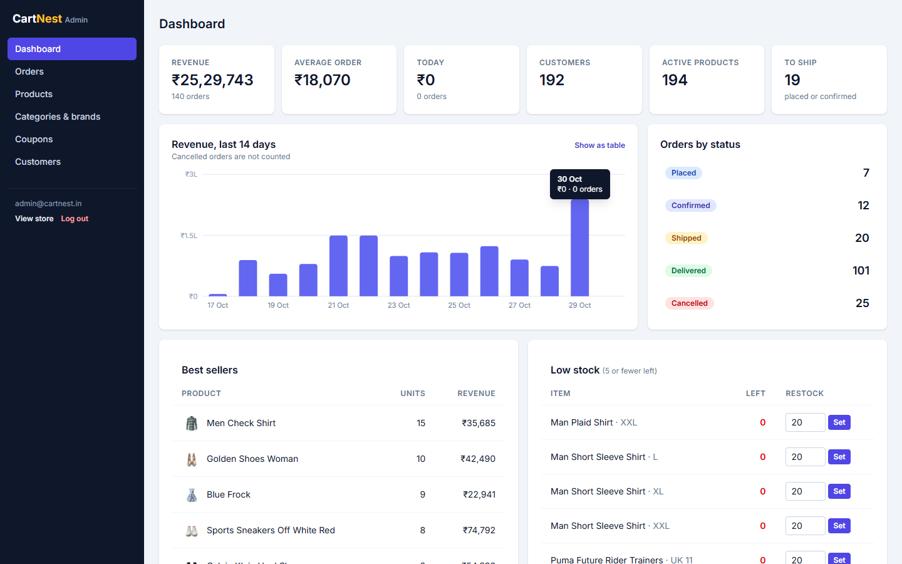 | 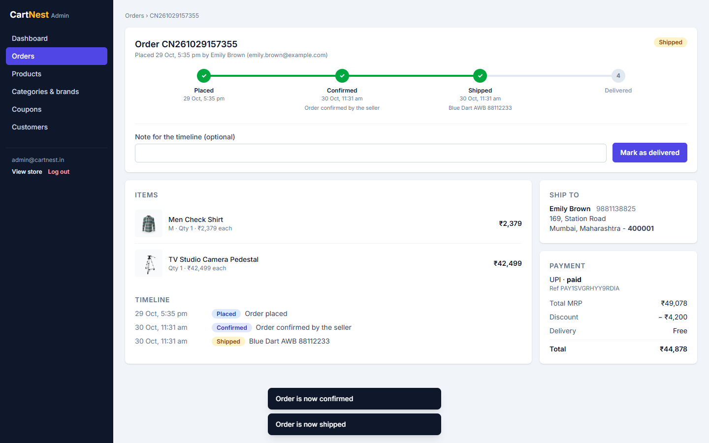 | 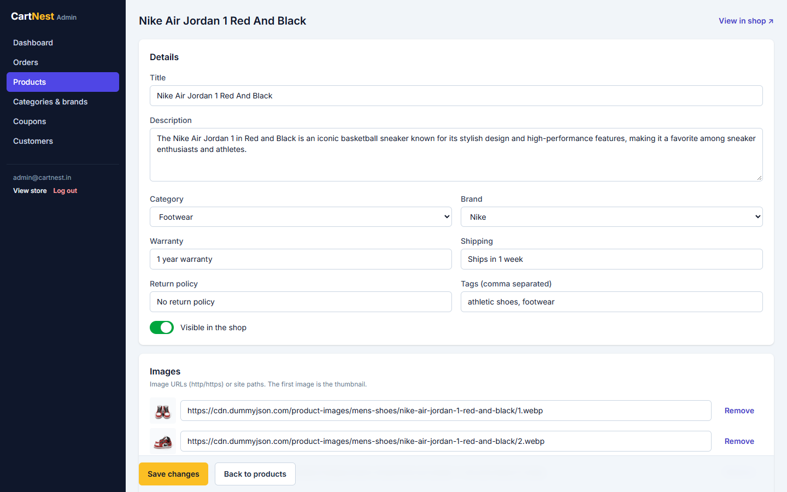 |
| 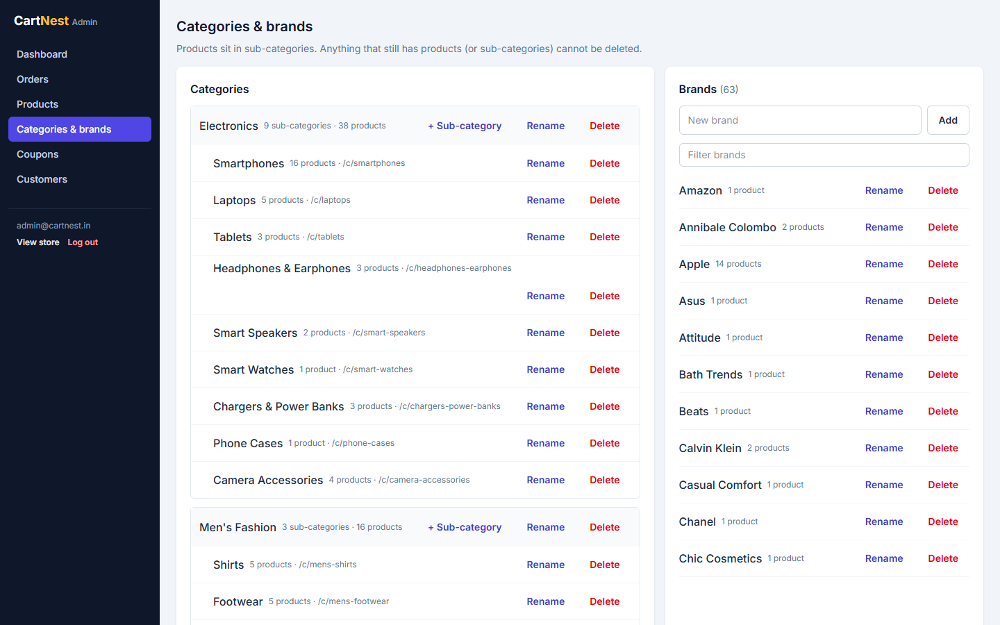 | 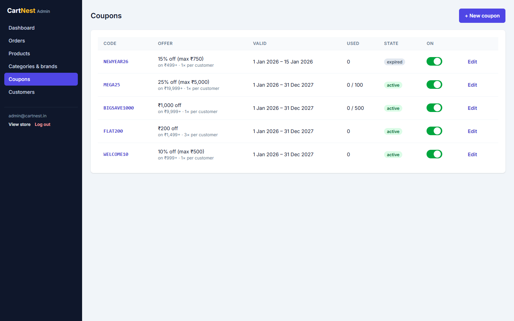 | 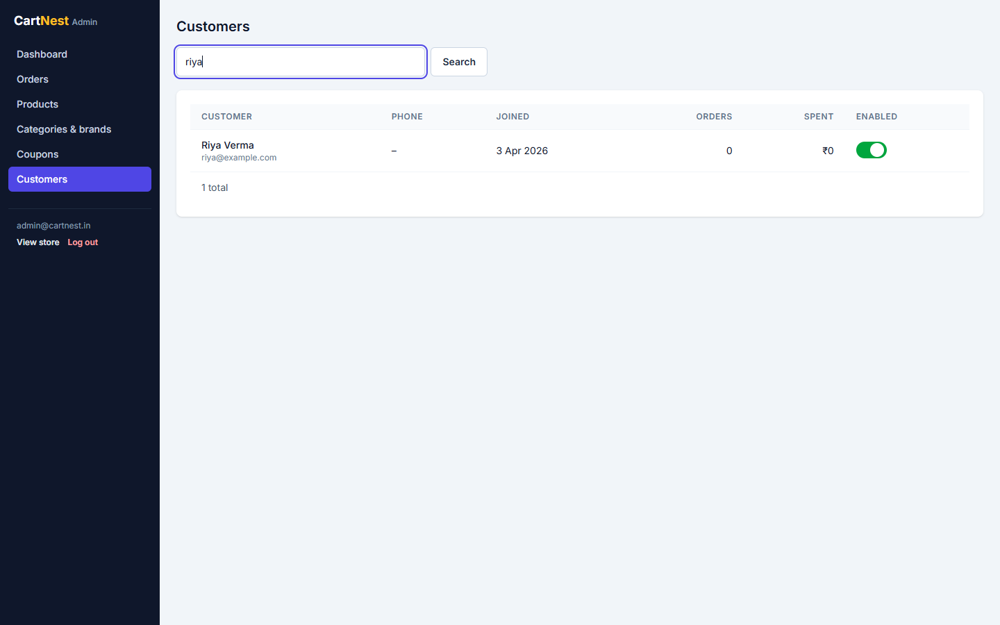 |

| | | |
|---|---|---|
| 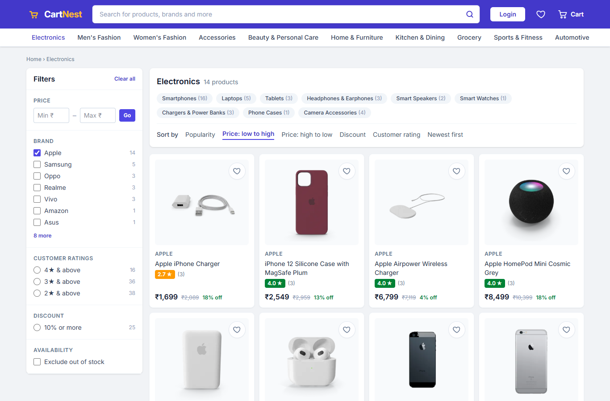 | 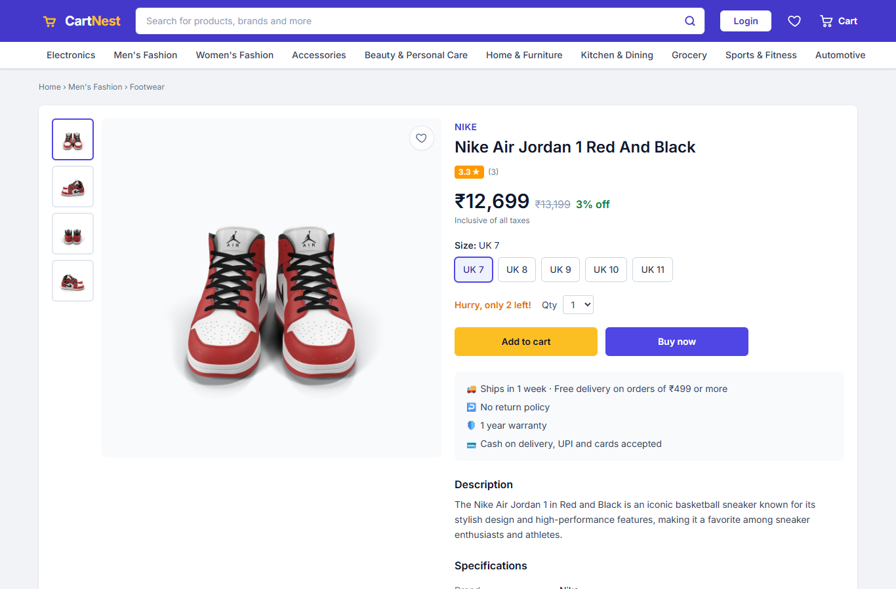 | 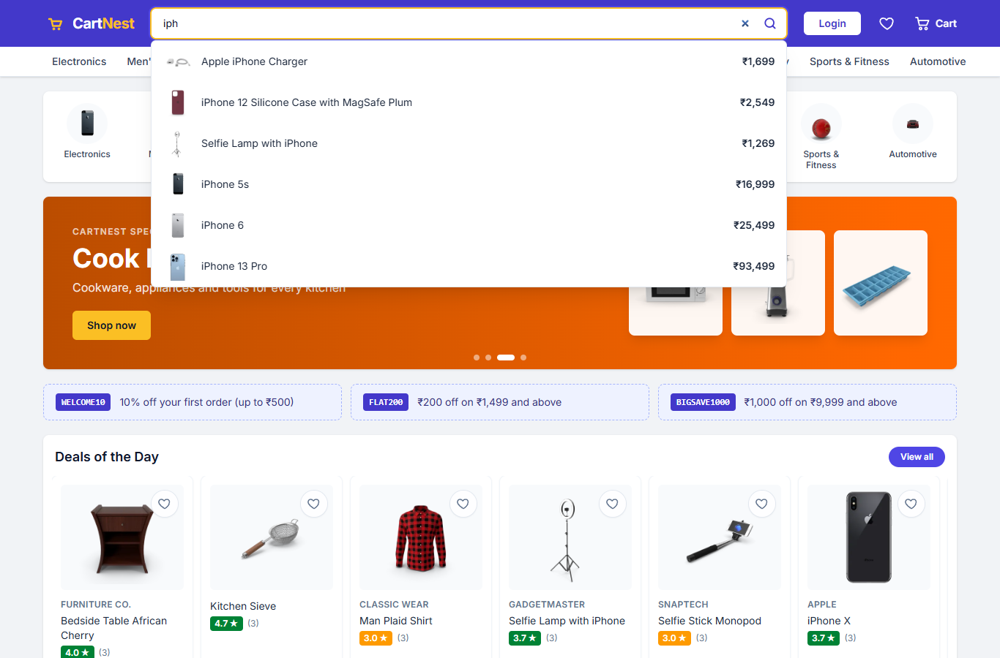 |
| 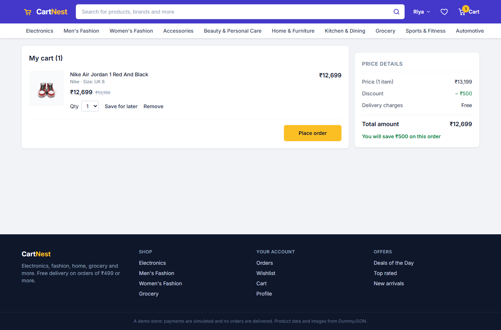 | 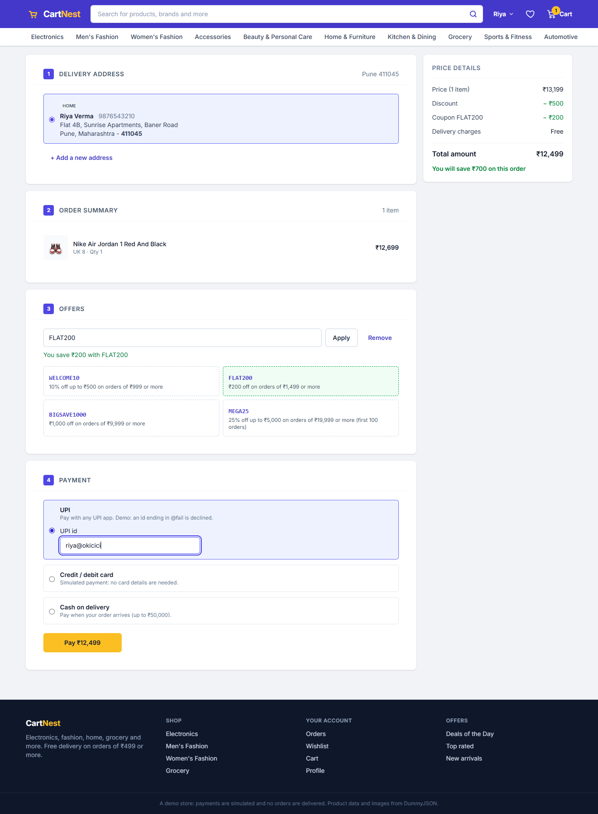 | 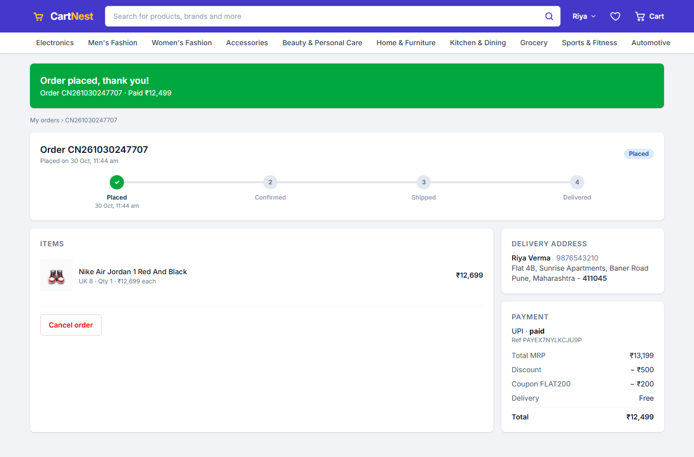 |

| Mobile | | |
|---|---|---|
| 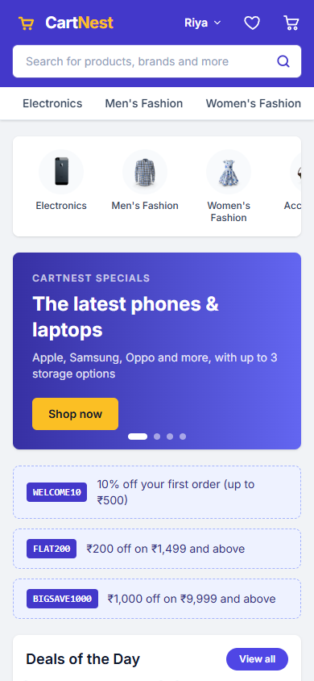 | 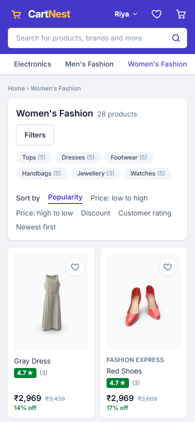 | 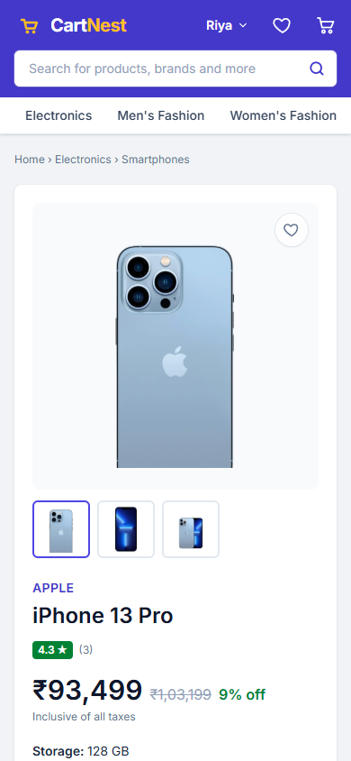 |

## Design notes

- **Database:**
  - Flyway owns the schema (`V1__catalog_schema.sql`); Hibernate only validates the mapping against it (`ddl-auto=validate`).
  - The tables have foreign keys, unique constraints (email, slugs, SKU, one review per customer per product) and CHECK constraints (price ≤ MRP, stock ≥ 0, rating 1–5).
- **Variants:** every product has at least one variant, and the variant is what is stocked and bought. The product row keeps a copy of its cheapest variant's price, MRP and discount, so listing pages can filter and sort without joining the variants.
- **Ratings:** the product row also keeps the average rating and review count.
- **Security:** stateless JWT (HMAC-SHA256, jjwt). The user id is the token subject. Login goes through Spring Security's `AuthenticationManager` (BCrypt), and one filter turns a valid token into the logged-in user.
- **Filtering:** search filters are JPA Specifications, small WHERE-clause pieces combined per request.
- **Facets and categories:** both are worked out with Java Streams. The category tree is built in memory from one query.
