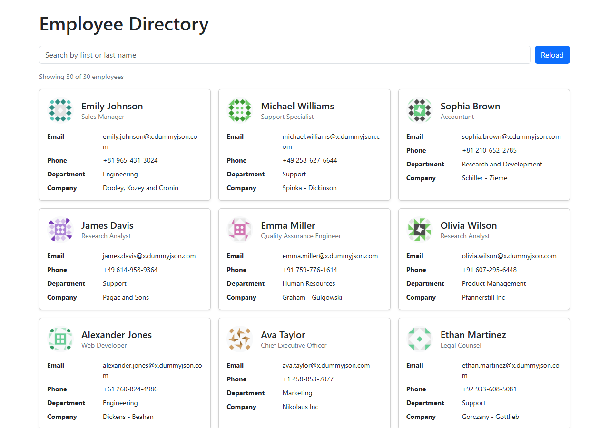
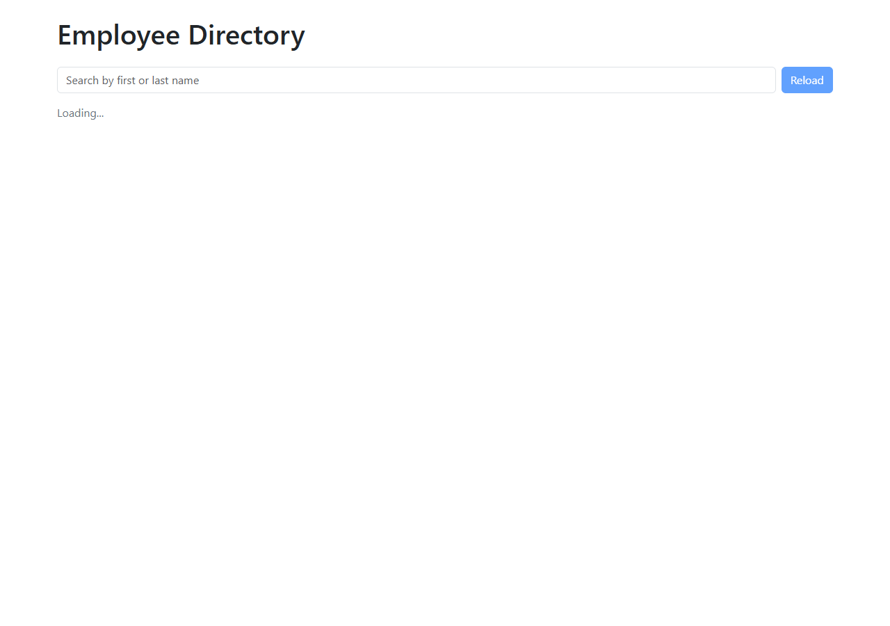
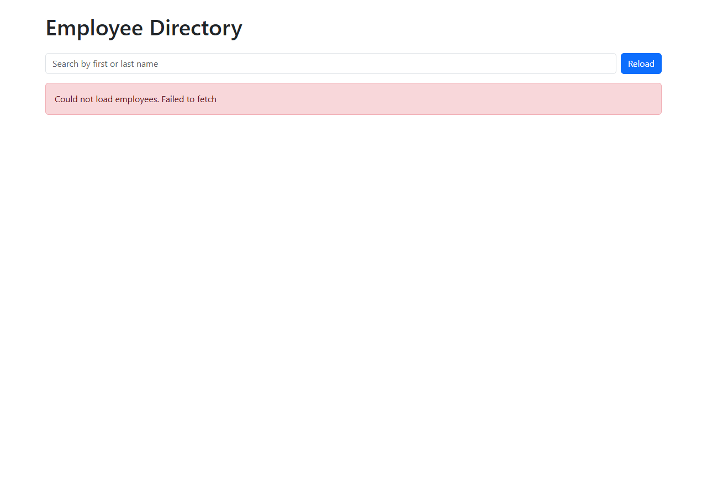
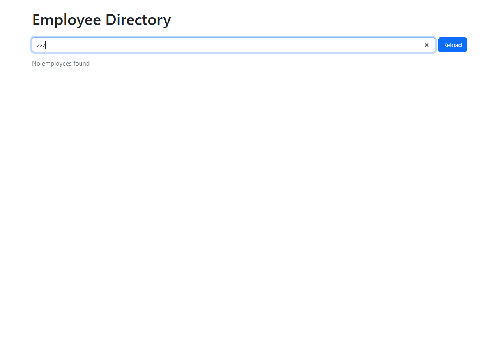
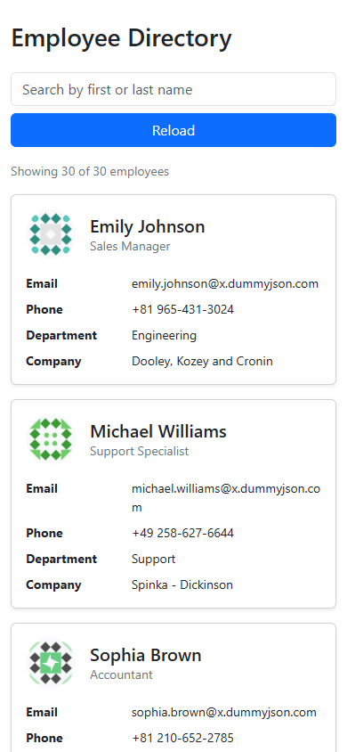

# Employee Directory (React + REST API)

A small React app that loads employees from a REST API when it starts and shows them as responsive cards.

**REST API endpoint:** `GET https://dummyjson.com/users`

## Setup and run

Requires Node.js 20 or newer and an internet connection (the data comes from the live API).

1. Install the dependencies with `npm install`: once in the `React` folder (this app is part of that npm workspace), or in this folder when it is used on its own.
2. In this folder:

   ```bash
   npm run dev       # http://localhost:5401
   ```

3. Build for production: `npm run build`, then `npm run preview` (http://localhost:5501).

## Technology

React 19, Vite 8, Bootstrap 5.3 (installed from npm), `fetch()`, `useEffect()`, `useState()`.

## Structure

```text
src/
├── main.jsx                      renders <App />, imports Bootstrap CSS
├── App.jsx                       page title "Employee Directory" + <EmployeeList />
├── api/employees.js              fetch() call to the REST API, returns data.users
└── components/
    ├── EmployeeList.jsx          state, useEffect, loading / error / empty states, search, reload
    └── EmployeeCard.jsx          one employee, received through props
```

## Component flow

`App` → `EmployeeList` → `useEffect` → `fetchEmployees()` → `fetch('https://dummyjson.com/users')` → JSON `{ users: [...] }` → `setEmployees(users)` → `EmployeeCard` for each employee

## Fields displayed

The response is an object with a `users` array. From each user the app shows:

| UI | JSON field |
|---|---|
| Name | `firstName`, `lastName` |
| Job title | `company.title` |
| Email | `email` |
| Phone | `phone` |
| Department | `company.department` |
| Company | `company.name` |
| Photo | `image` |

## How the requirements are met

| Requirement | Implementation |
|---|---|
| Vite React app | created with Vite; `npm run dev` |
| `EmployeeList` component | `src/components/EmployeeList.jsx` |
| `fetch()` on load | `fetchEmployees()` in `src/api/employees.js` |
| `useEffect()` starts the request | the effect runs after the first render (and when Reload changes `reloadCount`) |
| `useState()` stores the data | `employees`, `loading`, `error`, `search`, `reloadCount` |
| Table or responsive cards | Bootstrap cards in `col-12 col-md-6 col-lg-4`: 1 per row on phones, 2 on tablets, 3 on desktops |
| Loading state | `Loading...` while the request is in progress |
| Error state | a red Bootstrap alert, e.g. "Could not load employees. Failed to fetch". A non-OK HTTP status (e.g. 500) is also treated as an error, because `fetch()` only rejects on network failures |
| Empty state | `No employees found` when the collection is empty (or nothing matches the search) |

The effect uses an `ignore` flag in its cleanup, so a response that arrives after the component is gone (or after a newer request started) is not stored.

## Optional challenges implemented

1. **Search box:** filters by first or last name, case-insensitive, as you type.
2. **Reload button:** calls the API again (it is disabled while loading).
3. **Bootstrap:** responsive grid, cards, form control, button and alert.
4. **`EmployeeCard` component:** receives each employee through the `employee` prop.

## Tests

`npm test` runs 7 tests with a mocked `fetch`: the API is called with the right URL and `Loading...` shows first; the fields are displayed; a network failure and an HTTP 500 both show an error; an empty `users` array shows "No employees found"; search filters by name; Reload calls the API again.

## Screenshots

**Successful employee list** (live data from the API)



| Loading | Error (request blocked) |
|---|---|
|  |  |

| No employees found (search with no match) | Mobile (390 px) |
|---|---|
|  |  |

The loading and error screenshots were taken by delaying and then blocking the request to `dummyjson.com` in the browser.
