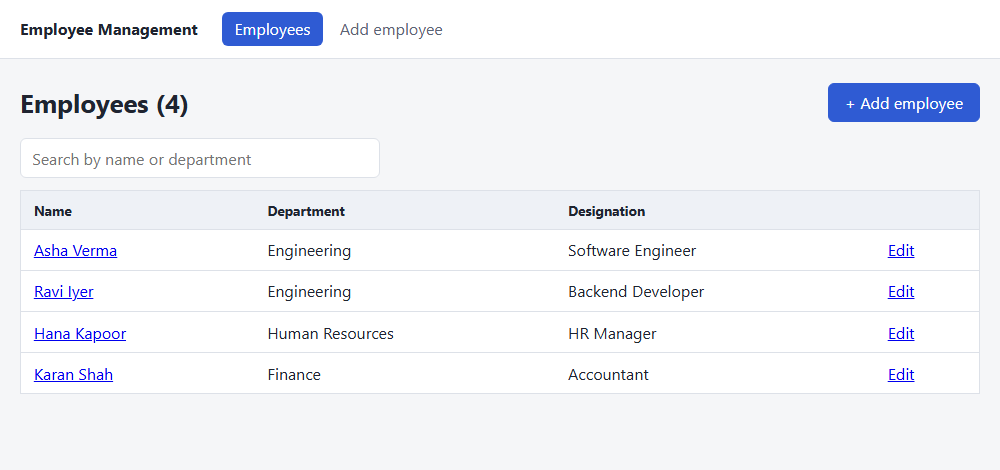
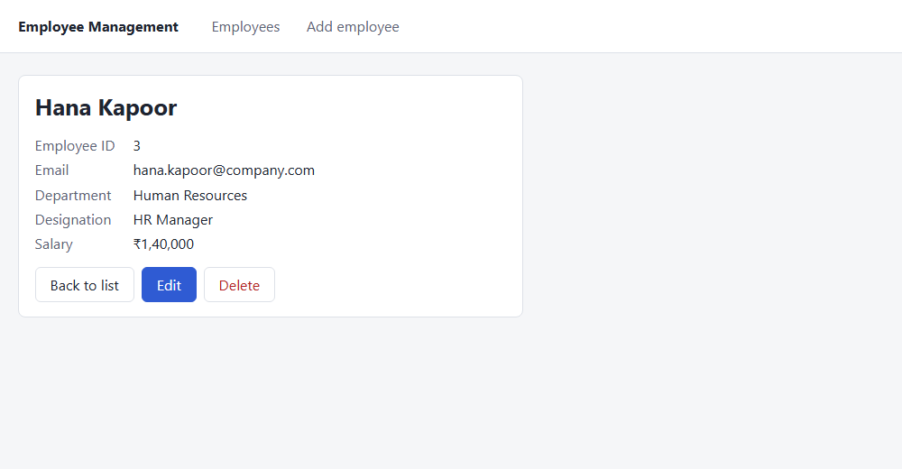
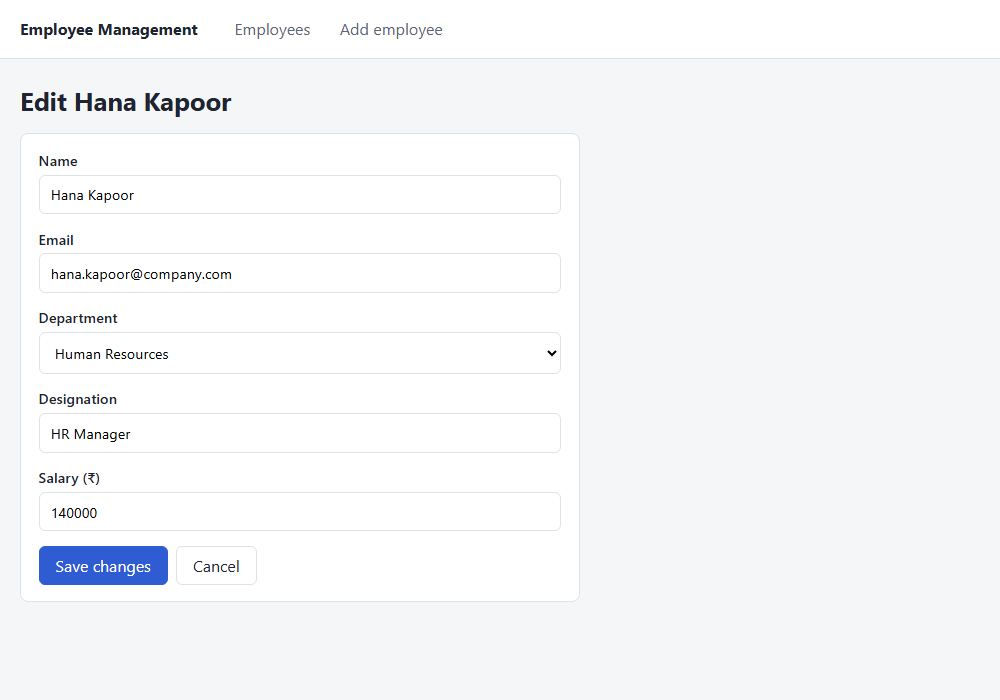
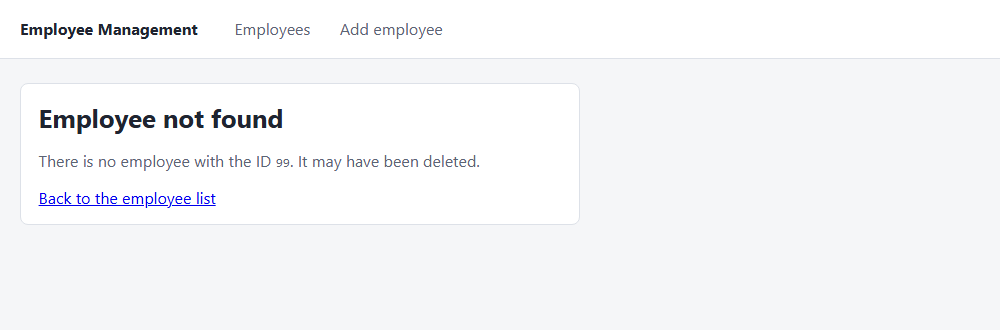

# Exercise 13 · Employee Management SPA

A small single-page application that combines **routing**, **forms** and **state management**: list, add, view, edit and delete employees.

## Run

From the `React` folder, run `npm install` once. Then, in this folder:

```bash
npm run dev     # http://localhost:5213
npm test
```

## Routes

| Path | Page | Notes |
|---|---|---|
| `/` | redirect | → `/employees` |
| `/employees` | Employee list | search by name or department; link to each employee; Edit link |
| `/employees/new` | Add employee | empty `EmployeeForm`; after saving → the new employee's details |
| `/employees/:id` | Employee details | Edit and Delete (with confirmation); after delete → the list |
| `/employees/:id/edit` | Edit employee | `EmployeeForm` pre-filled; after saving → the details |
| `*` | 404 Page Not Found | |

An unknown or non-numeric `:id` (`/employees/99`, `/employees/abc`, and the same on `/edit`) shows **"Employee not found"** with a link back to the list.

## State design

```text
<EmployeeProvider>                 context: employees[] + addEmployee, updateEmployee, deleteEmployee, findEmployee
 └─ <Routes>
     ├─ EmployeeListPage           reads employees; search text is local state; the filtered list is derived
     ├─ EmployeeCreatePage         addEmployee(data) → navigate(`/employees/${id}`)
     ├─ EmployeeDetailsPage        findEmployee(id); deleteEmployee(id) → navigate('/employees')
     └─ EmployeeEditPage           updateEmployee(id, data) → navigate(`/employees/${id}`)
```

- **Shared data:** the employee list lives in **one place**, `EmployeeContext`. All four pages read it with the `useEmployees()` hook, so the pages stay in sync without passing props through the router. This is the optional challenge.
- **Immutable updates:** add uses spread, update uses `map`, delete uses `filter`. New IDs are the highest existing ID + 1.
- **Local state only where it belongs:**
  - the form's fields and the `touched` map live in `EmployeeForm`
  - the search text lives in the list page
  - the "confirm delete" toggle lives in the details page
- **Messages after navigation** ("Neha Joshi was added.", "Changes saved.", "Karan Shah was deleted.") are passed with `navigate(path, { state: { message } })` and read with `useLocation()`.
- **Nothing is duplicated:** counts and the filtered list are derived on render.

## Validation rules (`validateEmployee.js`)

| Field | Rule |
|---|---|
| Name | required, at least 2 characters |
| Email | required, `name@domain.tld` format, **unique** among the other employees (case-insensitive; editing an employee may keep its own email) |
| Department | must be selected |
| Designation | required |
| Salary | required, greater than 0, at most ₹1,00,00,000 |

- **One form for both pages:** `EmployeeForm` is used by both "add" and "edit". Errors appear under each field after the field is left, and all of them on a submit attempt.
- **Clean data:** only valid, trimmed data is passed to `onSubmit`.

## Screenshots

| Employee list | Employee details |
|---|---|
|  |  |

| Edit employee | Unknown ID |
|---|---|
|  |  |

## Tests (13)

- **Validation:** a valid employee passes; every empty field, a duplicate email (other case), a salary of 0 and a 1-character name are rejected.
- **Routing:** `/` redirects to the list; unknown IDs (`99`, `abc`, `99/edit`) show "Employee not found"; unknown paths show 404.
- **Create:** fills the form → lands on the new employee's details with a message → the list now has 5.
- **Invalid submit:** errors are shown and the page doesn't change.
- **Edit:** the form is pre-filled → save → back on the details with the new designation.
- **Delete:** confirm → back on the list with a message, and the employee is gone (3 left).
- **Empty cases:** an empty list, and a search with no matches.
