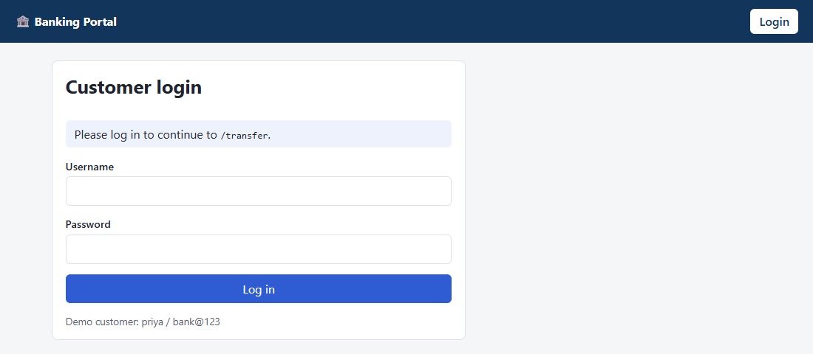
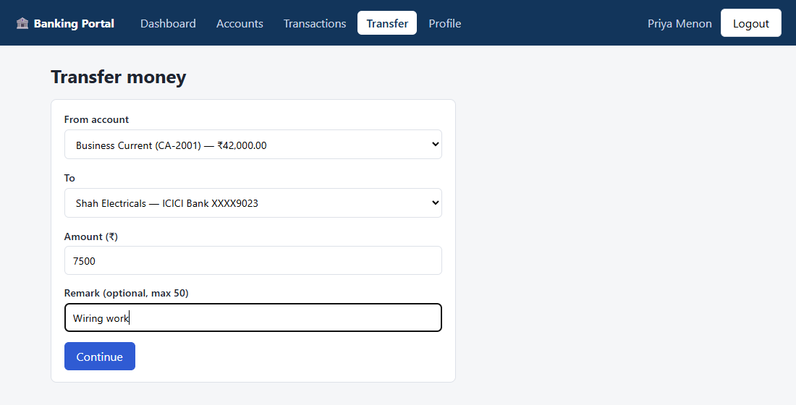
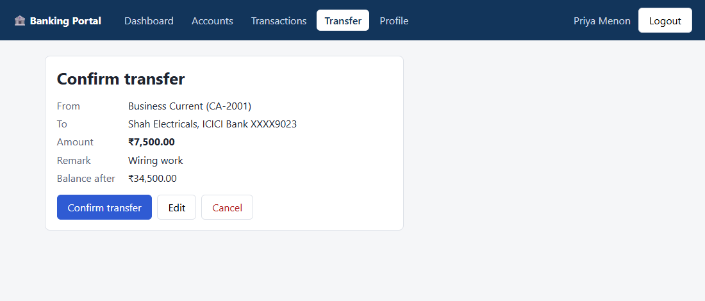
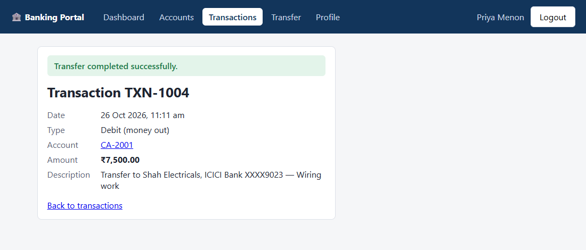
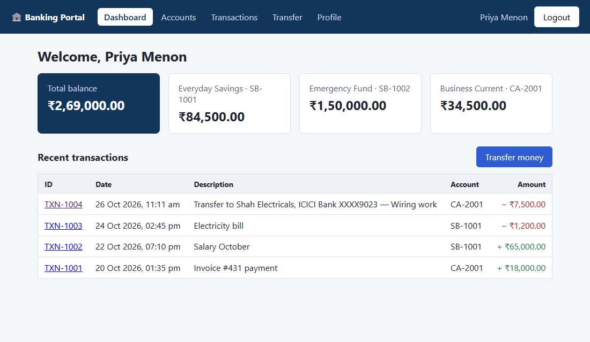
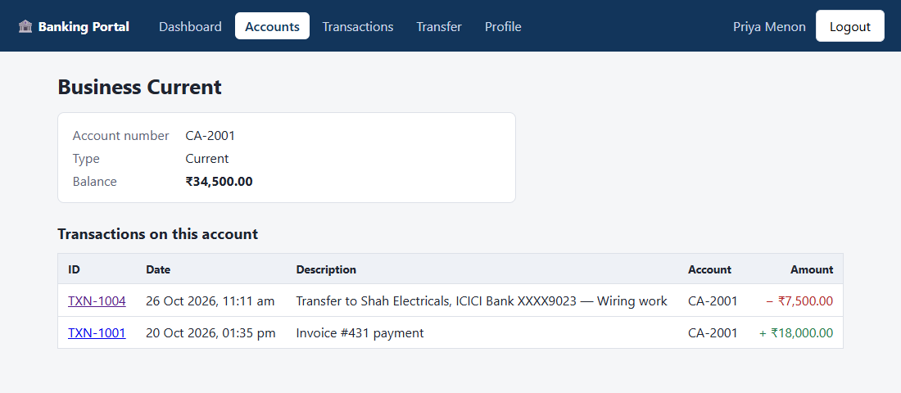

# Exercise 14 · Banking Customer Portal

A small banking portal that combines **routing** (protected pages, URL parameters), **forms** (a validated transfer form with a confirmation step) and **state management** (Context + `useReducer`).

## Run

From the `React` folder, run `npm install` once. Then, in this folder:

```bash
npm run dev     # http://localhost:5214  — demo customer: priya / bank@123
npm test
```

## Routes

| Path | Access | Page |
|---|---|---|
| `/login` | public | Customer login; returns to the page that was requested |
| `/` | protected | → `/dashboard` |
| `/dashboard` | protected | total balance, one tile per account, 5 most recent transactions |
| `/accounts` | protected | list of accounts |
| `/accounts/:accountId` | protected | **URL parameter**: account details and its transactions ("Account not found" for unknown IDs) |
| `/transactions` | protected | all transactions, with a filter by account |
| `/transactions/:transactionId` | protected | **URL parameter**: one transaction ("Transaction not found" for unknown IDs) |
| `/transfer` | protected | Transfer Money form |
| `/transfer/confirm` | protected | **confirmation page** before the money moves (challenge) |
| `/profile` | protected | customer details |
| `*` | public | 404 Page Not Found |

**Route protection:**
- Every page except Login is a child of `<RequireAuth />`. Without a logged-in user it renders `<Navigate to="/login" state={{ from }} />`, and after logging in the user is sent back to `from`.
- **Logout** clears the user (and any pending transfer) and returns to Login.

## State design

```text
<BankProvider>                   Context: { user, accounts, transactions, pendingTransfer, lastTransferId } + actions
 │   useReducer(bankReducer)     LOGIN · LOGOUT · PREPARE_TRANSFER · CANCEL_TRANSFER · COMPLETE_TRANSFER
 └─ <Routes> … every page calls useBank()
```

- **Shared banking state:** the balances and the transaction history live in **one reducer**, provided to every page by `BankContext`. A transfer done on `/transfer` is immediately visible on the dashboard, the account page and the transaction list.
- **Pure reducer:** `bankReducer` never mutates the state, and the timestamp comes from the action. `COMPLETE_TRANSFER`:
  - **debits** the source account
  - **credits** the destination (when it's one of the customer's own accounts)
  - **records** a DEBIT transaction, plus a CREDIT one for own-account transfers
  - clears the pending transfer and stores `lastTransferId`

  It checks the balance again, so it can never overdraw, even if the form check were skipped.
- **The confirmation step:** `/transfer` only **prepares** a transfer (`PREPARE_TRANSFER` stores it as `pendingTransfer`). `/transfer/confirm` shows it with the balance after. From there:
  - **Confirm** completes it and opens the new transaction's page.
  - **Edit** returns to the form with the values kept.
  - **Cancel** drops it, so no money moves.

  Opening `/transfer/confirm` with nothing pending goes back to the form.
- **Derived values:** the total balance, the filtered transaction lists and "balance after" are computed on render, never stored.

## Validation rules (`validateTransfer.js`)

| Field | Rule |
|---|---|
| From account | required |
| To | required (own account or saved payee); **not the same account** as From |
| Amount | required, greater than 0, at most 2 decimal places, **at most the available balance**, at most the **daily limit of ₹1,00,000** |
| Remark | optional, at most 50 characters |

Errors appear under each field after the first Continue. The reducer checks the balance a second time on Confirm.

## Screenshots

| Protected page → login | Transfer form |
|---|---|
|  |  |

| Confirmation (challenge) | Transaction details (`/transactions/:transactionId`) |
|---|---|
|  |  |

| Dashboard after the transfer | Account details (`/accounts/:accountId`) |
|---|---|
|  |  |

The screenshots come from a real browser run of the built app: log in, transfer ₹7,500, confirm, then the dashboard and account page show the new balance and transaction.

## Tests (18)

- **Validation:**
  - a valid transfer passes
  - missing fields, the same account, ₹0 and 3 decimal places are rejected
  - **boundaries:** exactly the balance is allowed, ₹1 more is rejected; the ₹1,00,000 daily limit
- **Reducer:**
  - an own-account transfer debits, credits and records two transactions, without mutating the old state
  - an overdrawing `COMPLETE_TRANSFER` is ignored
- **Protection:**
  - five protected URLs redirect to Login
  - logging in returns to the requested page
  - Logout locks the portal again
  - wrong credentials are rejected
- **Transfer flow (UI):** an invalid submit stays on the form → Continue → the confirmation shows the balance after → Edit keeps the values → Confirm → transaction details with a success message → the account page shows the new balance.
- **Cancel** on the confirmation page moves no money. **Confirm with nothing pending** redirects to the form.
- **URL parameters:** an account page by ID; unknown account and transaction IDs.
