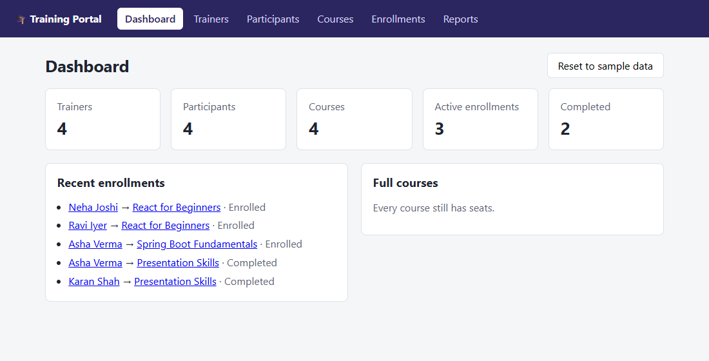
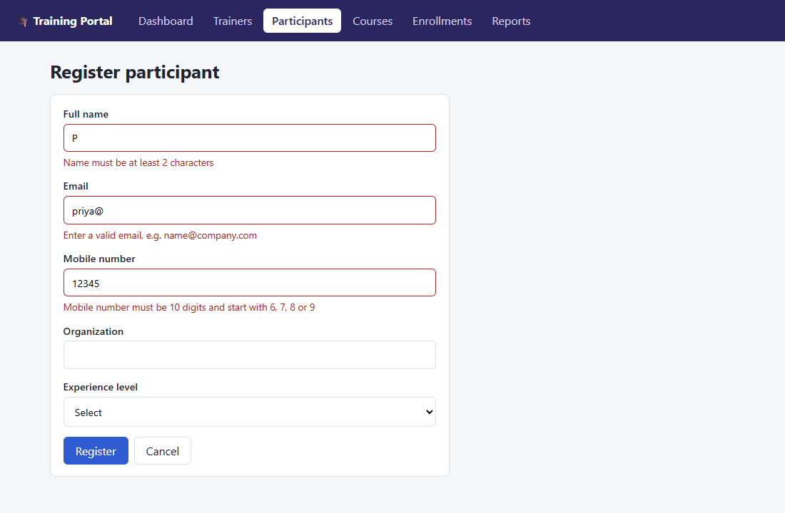
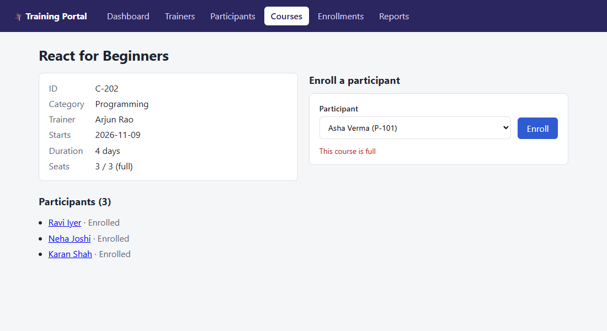
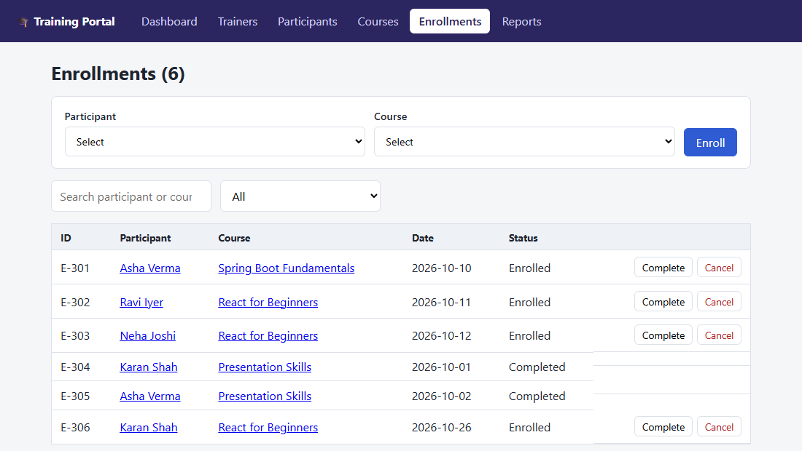
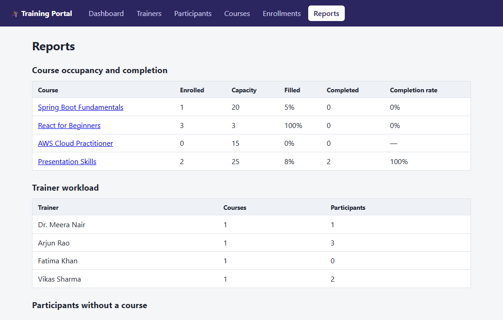

# Exercise 15 · Mini Project — Training Management Portal

A training-management application that combines **routing**, **forms** and **state management**:
- trainers, participants, courses and enrollments
- validated registration and course-creation forms
- enrolling participants in courses
- search and filters
- a dashboard and reports

Data is kept in **centralised state (Context + `useReducer`)** and **saved to `localStorage`**.

## Run

From the `React` folder, run `npm install` once. Then, in this folder:

```bash
npm run dev     # http://localhost:5215
npm test
```

The app starts with sample data. Changes are saved in the browser and survive a reload. **Reset to sample data** on the dashboard restores the original data.

## Routes

| Path | Page |
|---|---|
| `/` | → `/dashboard` |
| `/dashboard` | summary: trainers, participants, courses, active and completed enrollments; recent enrollments; full courses; Reset |
| `/trainers` | trainers with their courses; search by name or expertise |
| `/participants` | participant list; search by name, organization or ID; filter by experience level |
| `/participants/new` | **participant registration form** |
| `/participants/:participantId` | **dynamic route**: details, the participant's courses, enrol into a course |
| `/courses` | course list with seats used; search by title or trainer; filter by category |
| `/courses/new` | **course creation form** |
| `/courses/:courseId` | **dynamic route**: details, seats, enrolled participants, enrol a participant |
| `/enrollments` | enrol form; all enrollments; search; filter by status; mark Completed or Cancel |
| `/reports` | course occupancy and completion rate; trainer workload; participants without a course |
| `*` | 404 Page Not Found |

Unknown IDs (`/participants/P-999`, `/courses/C-999`) show "Participant not found" / "Course not found".

## State design

```text
<TrainingProvider>    Context value: { state, addParticipant, addCourse, enroll, completeEnrollment,
 │                                     cancelEnrollment, resetData, trainerById, participantById, courseById }
 │   useReducer(trainingReducer, undefined, loadData)      ← initial state read from localStorage (lazy)
 │   useEffect(() => localStorage.setItem(...), [state])   ← every change is saved
 └─ <Routes> … every page calls useTraining()

state = { trainers[], participants[], courses[], enrollments[] }
          enrollment = { id, participantId, courseId, date, status: 'Enrolled' | 'Completed' }
```

- **One reducer:** all four collections live in **one place**, and `trainingReducer` is the only code that changes them. Its actions: `ADD_PARTICIPANT`, `ADD_COURSE`, `ENROLL`, `COMPLETE_ENROLLMENT`, `CANCEL_ENROLLMENT`, `RESET_DATA`.
- **Pure:** it never mutates the old state. New IDs (`P-105`, `C-205`, `E-306`) follow the highest existing number, and the enrolment date comes with the action.
- **Enrolment rules** (`enrollmentProblem`) are shared by the forms (to show the message) and the reducer (as a guard). A participant can't be enrolled twice in the same course, and a course can't be over-filled.
- **References, not copies:** enrollments store only IDs. Names, seat counts, dashboard numbers and report percentages are **derived on render**, so nothing is duplicated.
- **Persistence:** `loadData()` uses the saved data only if it has the expected shape (four arrays). Missing or corrupt data falls back to the sample data, and storage errors are caught.

## Validation rules (`validation.js`)

**Participant registration**

| Field | Rule |
|---|---|
| Full name | required, at least 2 characters |
| Email | required, valid format, **not already registered** (case-insensitive) |
| Mobile number | required, 10 digits starting with 6–9 |
| Organization | required |
| Experience level | Beginner, Intermediate or Advanced |

**Course creation**

| Field | Rule |
|---|---|
| Title | required, at least 3 characters, **unique** (case-insensitive) |
| Category | one of Programming, Cloud, Data, Soft Skills |
| Trainer | an existing trainer |
| Start date | a valid date |
| Duration | whole number, 1–90 days |
| Capacity | whole number, 1–100 seats |

**Enrolment:** a participant and a course must be chosen; no duplicate enrolment; the course must have a free seat.

How the forms behave:
- Both forms use the `useValidatedForm` hook and the reusable `Field` component.
- Errors appear under a field once it is left, and all of them on a submit attempt.
- After saving, the app navigates to the new record's details page.

## Screenshots

| Dashboard | Registration form with validation |
|---|---|
|  |  |

| Course details (`/courses/:courseId`) — full course refuses an enrolment | Enrollments |
|---|---|
|  |  |

| Reports |
|---|
|  |

The screenshots come from a real browser run of the built app. On the course page, one participant was enrolled (filling the last seat), then a second enrolment was refused.

## Tests (16)

- **Reducer:**
  - `ENROLL` adds an enrollment with the next ID, without mutating
  - duplicate and full-course enrollments are refused, and the reducer returns the same state
  - complete, cancel and reset
- **Validation:**
  - valid participant and course pass
  - a duplicate email, a bad phone and missing fields are rejected
  - **boundaries:** duration 0/90, capacity 101/1, and a duplicate title in a different case
- **Persistence:**
  - missing, corrupt or wrongly shaped storage gives the sample data
  - a change is saved, and still there after a restart
- **UI:**
  - the dashboard numbers are right
  - register: an invalid submit stays put; a valid one lands on P-105, then enrolment works
  - create a course with 1 seat: the first enrolment fills it, the second is refused
  - participant search and level filter; course category filter
  - unknown participant, unknown course and 404 pages
  - the report row for Presentation Skills: 2/25, 8% filled, 100% completed
